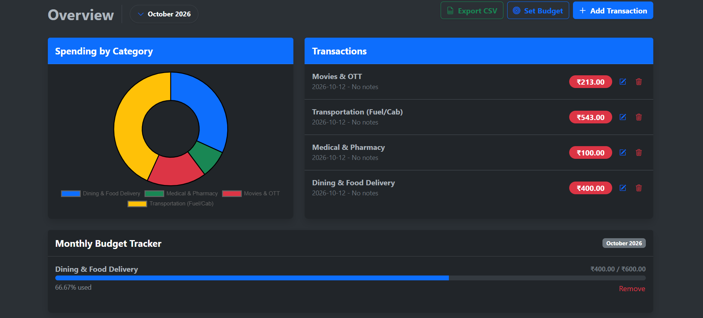
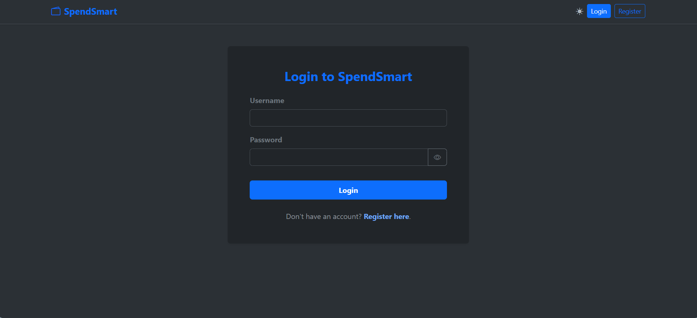
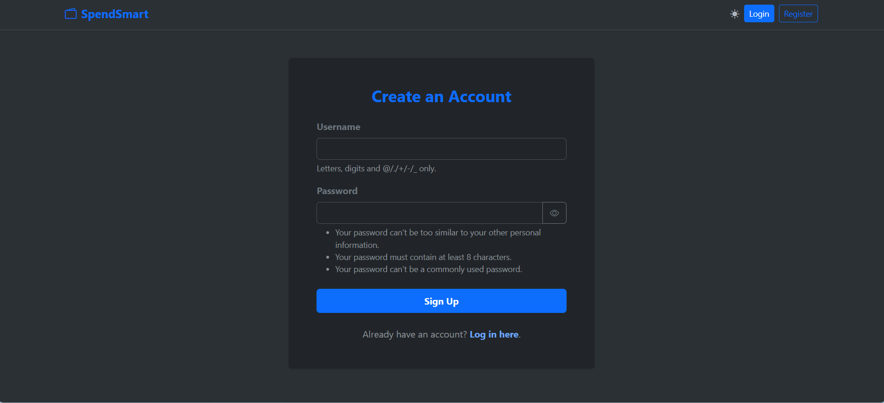
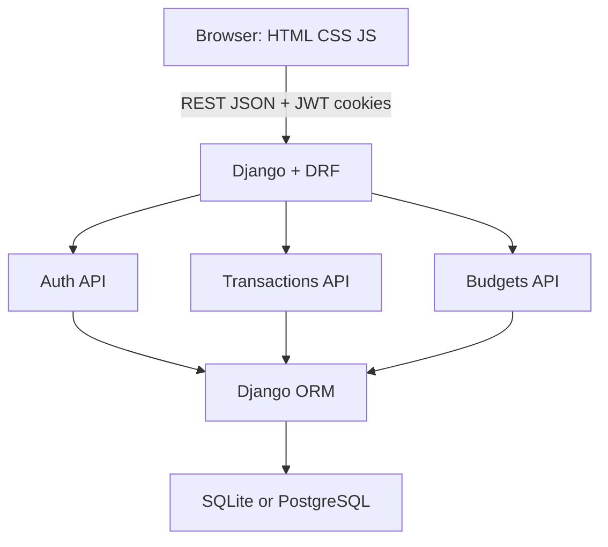

# SpendSmart

A personal finance tracker for logging income and expenses, setting monthly category budgets, and viewing spending at a glance.

**Live demo:** [https://spendsmart-uiqm.onrender.com/](https://spendsmart-uiqm.onrender.com/)

## Screenshots

Drop PNG files into the [`screenshots/`](screenshots/) folder using the names below. Capture them with a dummy account and sample amounts (not real personal data).

| Screen | File | What to capture |
|--------|------|-----------------|
| Dashboard (hero) | `screenshots/dashboard.png` | Overview with month picker, doughnut chart, transaction list, and budget cards |
| Login | `screenshots/login.png` | Login card at `/users/login/` |
| Register | `screenshots/register.png` | Register card with password rules |
| Add transaction | `screenshots/add-transaction.png` | Add Transaction modal or `/add/` form |
| Budgets | `screenshots/budgets.png` | Set Budget modal and/or progress bars |
| Dark mode | `screenshots/dashboard-dark.png` | Same dashboard after the theme toggle |

```markdown





```

Optional extra: a shot of the budget warning when a category is at or above 90% of its limit.

## Features

- Register and login with Django password validators
- JWT access and refresh tokens stored in HttpOnly cookies (not exposed to JavaScript)
- Income and expense transactions with categories (defaults plus custom)
- New transactions limited to the current month
- Doughnut chart of expenses by category
- Monthly budgets with remaining amount and usage percentage
- Alerts when a budget is at or above 90% used
- CSV export of the signed-in user’s transactions
- Light and dark theme
- Pagination on the transaction list

## Architecture

The UI is server-rendered HTML with Vanilla JavaScript. The browser talks to Django REST Framework over JSON. There is no WebSocket layer and no FastAPI/agent stack.

```
Frontend (HTML / CSS / JavaScript + Bootstrap + Chart.js)
              │
        REST API (JSON + HttpOnly JWT cookies)
              │
              ▼
       Django + DRF Backend
              │
              ▼
           URL Router
       ┌──────┼──────┐
       ▼      ▼      ▼
     Auth   Transactions  Budgets
      API       API         API
       │
       ▼
    Django ORM / Services
       │
       ▼
 SQLite (local) / PostgreSQL (Render)
```

- **Frontend:** Django templates in `users/` and `transactions/` (`login.html`, `register.html`, `dashboard.html`). Fetch calls go to `/api/...` with cookies included.
- **Auth API:** register, login (sets cookies), logout (clears cookies), current user (`/api/me/`). Custom JWT authentication reads the token from the `access_token` cookie.
- **Transactions API:** list/create, update/delete, categories, CSV export, chart aggregates.
- **Budgets API:** CRUD plus `/api/budgets/status/` which compares limits against expenses for a month.
- **Data:** `Category`, `Transaction`, and `Budget` models in [`transactions/models.py`](transactions/models.py). Django’s built-in `User` model is used for accounts.



## Tech stack

- Python / Django 6
- Django REST Framework and SimpleJWT
- Bootstrap 5, Bootstrap Icons, Chart.js (CDN)
- WhiteNoise and Gunicorn for production
- PostgreSQL on Render (`dj-database-url` + `psycopg2`)
- SQLite for local development via `DATABASE_URL`

## Project layout

```
SpendSmart/
├── SpendSmart/          # project settings, URLs, WSGI/ASGI
├── users/               # auth views, JWT cookie login, templates
├── transactions/        # models, serializers, APIs, dashboard templates
├── static/              # favicon
├── screenshots/         # README images
├── requirements.txt
├── build.sh             # Render: install, collectstatic, migrate
└── manage.py
```

## Local setup

1. Clone the repo and create a virtual environment.

```bash
python -m venv venv
venv\Scripts\activate
```

On macOS/Linux: `source venv/bin/activate`

2. Install dependencies.

```bash
pip install -r requirements.txt
```

3. Copy environment variables.

```bash
copy .env.example .env
```

On macOS/Linux: `cp .env.example .env`

4. Set a local `SECRET_KEY` in `.env` (do not use the example value in production). Keep `DATABASE_URL=sqlite:///db.sqlite3` for SQLite.

5. Migrate and run.

```bash
python manage.py migrate
python manage.py runserver
```

Open [http://127.0.0.1:8000/](http://127.0.0.1:8000/). Unauthenticated visitors are sent to login. Seeded default categories include Food & Dining, Transportation, Rent & Utilities, Shopping, Entertainment, Health, Salary, and Gifts.

### Environment variables

| Variable | Purpose |
|----------|---------|
| `SECRET_KEY` | Django secret. Required in production. |
| `DATABASE_URL` | Database URL. Local example: `sqlite:///db.sqlite3`. Render injects PostgreSQL. |
| `RENDER` | Set automatically on Render; turns `DEBUG` off and enables WhiteNoise `STATIC_ROOT`. |
| `RENDER_EXTERNAL_HOSTNAME` | Added to `ALLOWED_HOSTS` on Render. |

Never commit `.env`, `db.sqlite3`, or `security_alerts.log`. Those paths are already in `.gitignore`.

## Main pages

| Path | Page |
|------|------|
| `/users/login/` | Login |
| `/users/register/` | Register |
| `/` | Dashboard |
| `/add/` | Add transaction (standalone form; dashboard also has a modal) |
| `/admin/` | Django admin |

## API overview

All routes except register and login require an authenticated JWT cookie.

| Method | Path | Description |
|--------|------|-------------|
| POST | `/api/register/` | Create user |
| POST | `/api/login/` | Login; sets HttpOnly cookies |
| POST | `/api/logout/` | Clear cookies |
| GET | `/api/me/` | Current username |
| GET, POST | `/api/transactions/` | List (paginated + chart data) or create |
| PUT, DELETE | `/api/transactions/<id>/` | Update or delete own transaction |
| GET, POST | `/api/categories/` | List or create category |
| GET | `/api/export/csv/` | Download CSV |
| GET, POST | `/api/budgets/` | List or create budget |
| PUT, DELETE | `/api/budgets/<id>/` | Update or delete own budget |
| GET | `/api/budgets/status/` | Spent vs limit for the month |

## Deployment

The app is configured for [Render](https://render.com/). [`build.sh`](build.sh) installs packages, collects static files, and runs migrations. Production uses Gunicorn, WhiteNoise, and PostgreSQL.

Set `SECRET_KEY` and `DATABASE_URL` in the host’s environment. Do not rely on the local fallback secret in `settings.py`.

## Security notes

- JWT access tokens live in HttpOnly cookies (`AUTH_COOKIE_HTTP_ONLY`) so XSS cannot read them from JavaScript.
- SameSite Lax on auth cookies; CSRF middleware stays enabled for cookie-authenticated requests.
- Notes and category names are stripped of HTML tags in serializers.
- Transaction and budget queries are scoped to `request.user`.
- Django password validators enforce minimum length and reject common/numeric passwords.

## License

No license file is included. All rights reserved unless you add one later.
